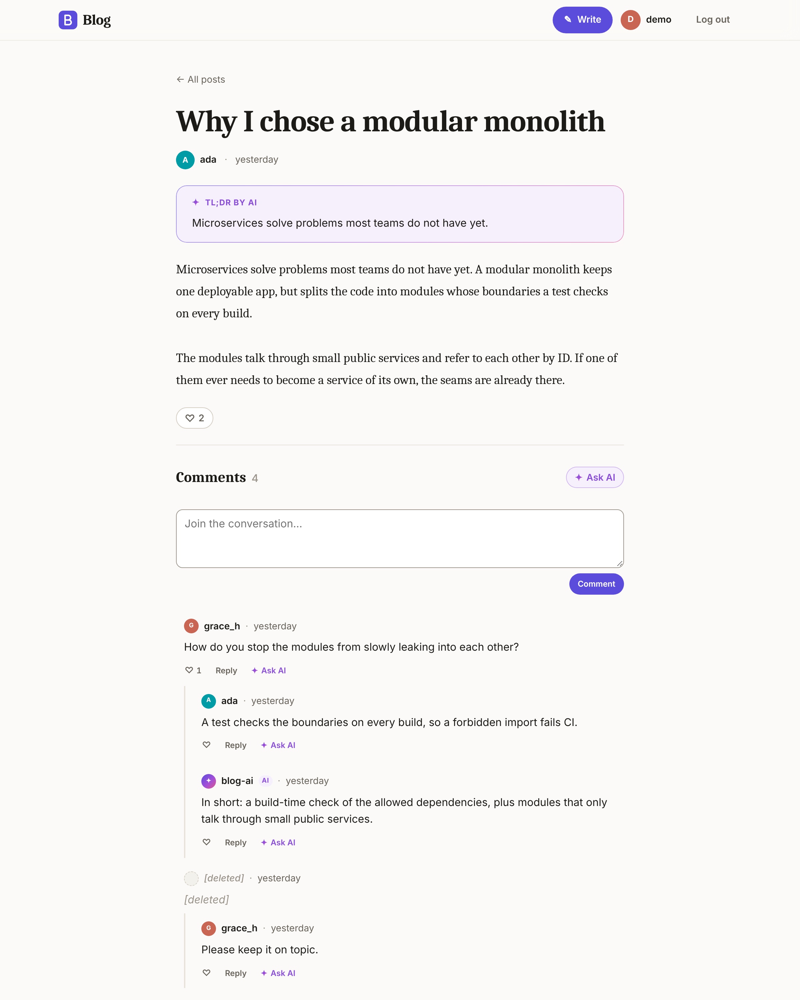
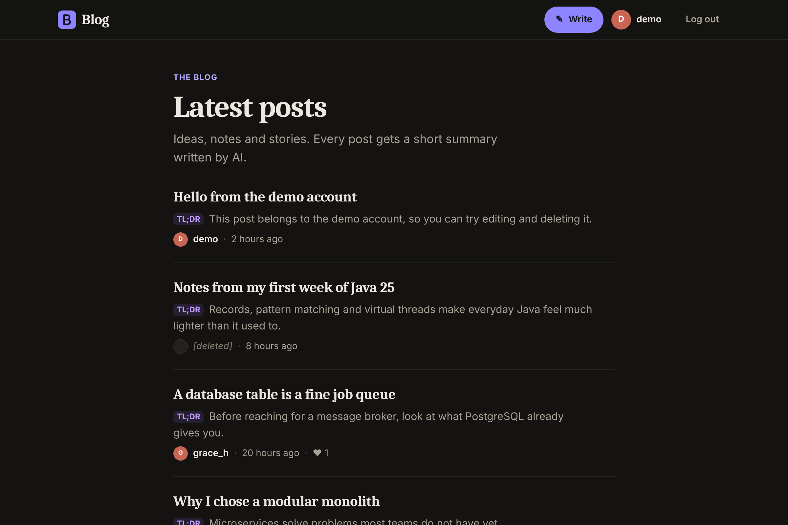
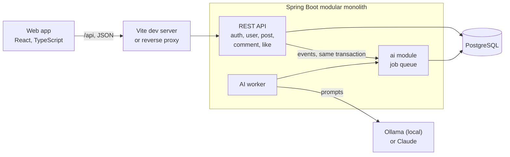

# Blog

[](https://github.com/E-L-R/blog/actions/workflows/ci.yml)

A blogging platform with AI built in. Every post gets a **TL;DR written by an AI**, and anyone can **ask the AI to join a discussion**: its answer appears as a comment by a bot user. Readers comment in threads, reply, and like posts and comments.

The backend is a **Spring Boot modular monolith** in Java 25, with PostgreSQL. The web app is a **React and TypeScript** single-page app. Locally, the AI runs on your own machine with [Ollama](https://ollama.com): no API key, no account, no cost.



## Quick start

You need:

| Tool | Version | For |
|---|---|---|
| [JDK](https://adoptium.net) | 25 | the backend |
| [Docker](https://www.docker.com/products/docker-desktop/) | any recent, running | PostgreSQL, started for you |
| [Node.js](https://nodejs.org) | 22.22 or newer | the web app |
| [Ollama](https://ollama.com/download) | any recent, running | the AI model |

**1. Download the model** (about 2 GB, once). `llama3.2` runs on an ordinary laptop, even without a graphics card:

```bash
ollama pull llama3.2
```

**2. Start the backend.** It starts PostgreSQL in Docker, creates the tables, and listens on port 8080:

```bash
./mvnw spring-boot:run
```

The log should contain `AI: Ollama model llama3.2 at http://localhost:11434 writes TL;DRs and replies`. On Windows, use `.\mvnw.cmd` instead of `./mvnw`.

**3. Start the web app**, in a second terminal:

```bash
cd frontend
npm install
npm run dev
```

**4. Open http://localhost:5173**, sign up, log in and write a post. Its TL;DR appears once the model has answered, usually within a minute; the first answer takes longest, while Ollama loads the model. Then press **Ask AI** on the post or on a comment.

<details>
<summary><b>Something not working?</b></summary>

- **The TL;DR stays at "Writing a summary…".** The backend's log says why, in a line that starts with `AI request`. The usual reasons: Ollama isn't running (start the app, or `ollama serve`), or the model wasn't pulled (`ollama pull llama3.2`; `ollama list` shows what you have).
- **The startup log says `the fake LLM` or `Claude model`.** The Ollama settings were overridden; start the backend without extra arguments.
- **Port 5173 or 8080 is in use.** Stop whatever runs there; both ports are fixed so the web app finds the backend.

The full guide, including slow machines, other models and Ollama in Docker, is in [docs/DEVELOPMENT.md](docs/DEVELOPMENT.md#ai-models).

</details>

### Other ways to run it

| Want to… | Run |
|---|---|
| Try the web app alone, without Java, Docker or Ollama | `npm run dev:mock` in `frontend/`, then log in as `demo@example.com` / `password123`. A mock API in the browser answers, with demo data. |
| Run the backend without Ollama | `./mvnw spring-boot:run -Dspring-boot.run.arguments=--blog.ai.fake=true`: a fake model answers at once, always with the same text |
| Use Claude instead of a local model | `ANTHROPIC_API_KEY=<key> ./mvnw spring-boot:run -Dspring-boot.run.arguments="--blog.ai.provider=anthropic --blog.ai.llm.model=claude-opus-5-5"` |
| Explore the API | Swagger UI at http://localhost:8080/swagger-ui.html, while the backend runs |
| Run every test, as CI does | `./mvnw verify` for the backend; `npm run check` and `npm run e2e` in `frontend/` |

## What's inside



**For readers and writers**
- Accounts: sign up, log in, and delete your account the way Reddit does it: your posts and comments stay, shown as "[deleted]", and your username is retired for good.
- Posts in plain text, with a TL;DR that an AI writes in the background, and rewrites when the content changes.
- Comment threads with replies at any depth. A deleted comment keeps its place, so the replies under it still make sense.
- Likes on posts and comments, which show the moment you click.
- **Ask AI** on any post or comment: a bot replies in the thread, taking the post and the comments above into account.
- A fast, accessible interface with a light and a dark theme, from phone to desktop.

**Under the hood**
- **A modular monolith.** The backend is split into modules (`user`, `post`, `comment`, `like`, `ai`, `auth`) that only talk through each other's public services and refer to each other's data by ID. [Spring Modulith](https://spring.io/projects/spring-modulith) checks the boundaries on every build, so a forbidden dependency fails CI. The web app's features have checked boundaries too, through ESLint.
- **AI that can't break the app.** Creating a post publishes an event, and the `ai` module queues a job in the same transaction. A background worker calls the model later, outside any transaction, so a slow or failing model can never roll back a post. The model is behind one small interface, with clients for Ollama and for Claude.
- **A job queue in PostgreSQL**, not a message broker. Workers claim jobs with `SELECT … FOR UPDATE SKIP LOCKED` and a lease, retry with exponential backoff, and keep every request as an audit trail. Safe with several instances running.
- **Correct under concurrency.** Two edits at the same moment can't overwrite each other (optimistic locking); two sign-ups can't both get a username (a unique index); a double-clicked like counts once (`INSERT … ON CONFLICT DO NOTHING`); and a TL;DR is only saved if the post's content hash still matches what the model read, so a summary of an old version never replaces a newer one.
- **The database guards the rules too.** Constraints back up the Java code: usernames unique ignoring case, a reply always on its parent's post, no password for the bot or deleted accounts.
- **Security.** Stateless JWT authentication, bcrypt passwords, errors as RFC 9457 Problem Details with stable codes, and user content that is never rendered as HTML, which a lint rule enforces.
- **A frontend built against the API's design.** A mock API implements the documented API in the browser, so pages were built and tested before their endpoints existed, and the frontend's tests need neither Docker nor the backend.

## Architecture



The browser only talks to its own origin: the Vite dev server, or a reverse proxy in production, forwards `/api` to the backend, so no CORS setup is needed. The AI worker runs inside the backend and calls the model outside any database transaction. [docs/ARCHITECTURE.md](docs/ARCHITECTURE.md) explains the modules and their rules, and [docs/DECISIONS.md](docs/DECISIONS.md) why each choice was made.

## Testing

| Level | What | Tools |
|---|---|---|
| Architecture | Module boundaries in the backend, feature boundaries in the frontend | Spring Modulith, ESLint |
| Backend | Each module against a real PostgreSQL, including its endpoints, its database constraints and the races the design claims to handle | JUnit 5, Testcontainers, MockMvc |
| AI | The worker with a fake model and a clock moved by hand: leases, retries, backoff, stale results; the Ollama client against a stand-in server | JUnit 5 |
| Frontend | Unit and page tests that render the real app against the mock API | Vitest, Testing Library, Mock Service Worker |
| End to end | The main flows in a real browser, against the mock API and against the real backend with PostgreSQL | Playwright |

CI runs all of it on every pull request, in three jobs. [docs/TESTING.md](docs/TESTING.md) lists every test and the promise it checks.

## Tech stack

| | |
|---|---|
| Backend | Java 25, Spring Boot 4.1, Spring Modulith, Spring Data JPA, Spring Security (JWT), Bean Validation |
| Database | PostgreSQL 18, Flyway |
| AI | Ollama (local models) or Claude (Anthropic Java SDK), behind one interface |
| Frontend | React 19, TypeScript, Vite, React Router, TanStack Query, CSS Modules |
| Testing | JUnit 5, AssertJ, Testcontainers; Vitest, Testing Library, Mock Service Worker, Playwright |
| Operations | Docker Compose, GitHub Actions, Spring Boot Actuator, Micrometer, springdoc-openapi |

## Project structure

```
src/main/java/io/github/elr/blog    the backend, one package per module
├── common/      shared infrastructure: the clock, error handling, the current user
├── user/        users, the AI bot user, deleted accounts
├── auth/        sign-up, JWT login, account deletion, security configuration
├── post/        posts and their TL;DR
├── comment/     comment threads, soft delete, the bot's replies
├── like/        likes on posts and comments
└── ai/          the job queue, the worker, prompts, the Ollama and Claude clients
src/main/resources/db/migration     Flyway migrations
frontend/src                        the web app
├── app/         routes, layout, providers
├── api/         the HTTP client and the API's types
├── components/  shared UI
├── features/    auth, posts, comments, likes, ai, account
└── mocks/       the mock API, for development and tests
docs/                               design documents
```

## Documentation

| Document | Contents |
|---|---|
| [docs/DEVELOPMENT.md](docs/DEVELOPMENT.md) | Running, testing and debugging on your machine; AI models; adding a module |
| [docs/ARCHITECTURE.md](docs/ARCHITECTURE.md) | Modules and their rules, events, the AI worker, security, error handling |
| [docs/DOMAIN.md](docs/DOMAIN.md) | Entities, business rules, the AI job's states, the main flows |
| [docs/DATABASE.md](docs/DATABASE.md) | Tables, constraints, indexes and migrations |
| [docs/API.md](docs/API.md) | REST endpoints, resources, errors and validation |
| [docs/FRONTEND.md](docs/FRONTEND.md) | The web app: features, pages, data fetching, the mock API, styling |
| [docs/TESTING.md](docs/TESTING.md) | Test strategy, every test, and the tests each feature needs |
| [docs/OPERATIONS.md](docs/OPERATIONS.md) | Configuration, profiles, monitoring, deployment, failure modes |
| [docs/DECISIONS.md](docs/DECISIONS.md) | Why the main choices were made, with their alternatives and costs |
| [CONTRIBUTING.md](CONTRIBUTING.md) | Workflow, commit messages, definition of done |
| [SECURITY.md](SECURITY.md) | The security model and its known limitations |
| [CHANGELOG.md](CHANGELOG.md) | Notable changes |

## Roadmap

Every planned step is built: the module structure and its checks; PostgreSQL with Flyway; CI; the `user`, `post`, `auth`, `comment`, `like` and `ai` modules with their endpoints; the OpenAPI description; local models through Ollama; and the web app, with end-to-end tests against the real backend.

Deliberately out of scope for now: email verification, moderation and admin roles, refresh tokens and logout (access tokens are short-lived), paginated comment threads, streaming AI answers, and editing the bot's comments. [SECURITY.md](SECURITY.md#known-limitations) lists the limitations that follow from these. Hosting is not chosen yet.

## License

[MIT](LICENSE)
