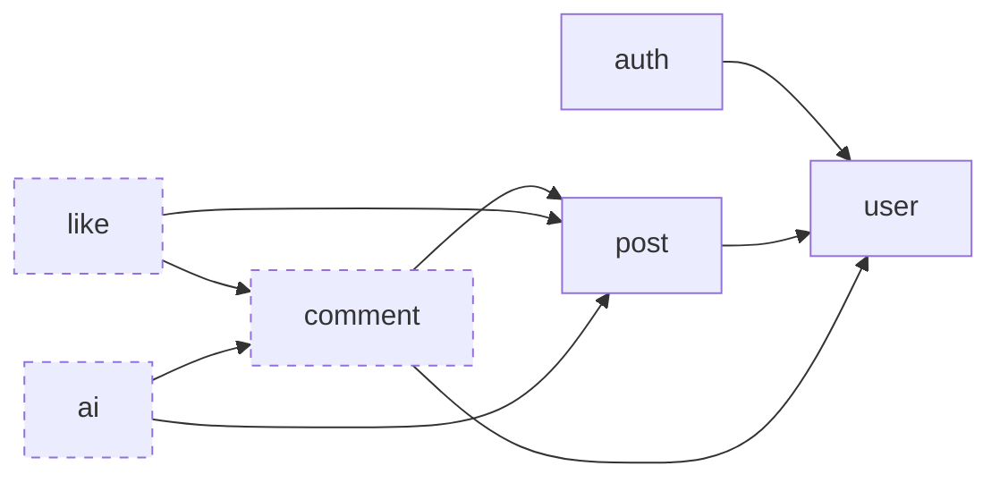

# Architecture

> **Status:** partly built. The module structure and its verification test, the `common`, `user` and `post` modules, the first part of `auth` (registration, the security configuration and error handling), PostgreSQL with Flyway, and CI exist. Events, the AI worker, tokens and the remaining endpoints are still design, marked *planned* with the roadmap step that adds them.

Related documents:
- [DOMAIN.md](DOMAIN.md): entities, rules and flows
- [DATABASE.md](DATABASE.md): tables, constraints and indexes
- [API.md](API.md): the REST endpoints
- [OPERATIONS.md](OPERATIONS.md): configuration, monitoring and failure modes
- [DECISIONS.md](DECISIONS.md): why the main choices were made
- [DEVELOPMENT.md](DEVELOPMENT.md): building, running and testing, and how to add a module

## Style: modular monolith (Spring Modulith)

The application is one deployable Spring Boot app, split into **feature modules**. Each module has layers inside it (web → service → domain/repository). A Spring Modulith test (`ModularityTests`) checks the module boundaries and fails the build when a rule is broken.

## Modules

Every direct sub-package of `io.github.elr.blog` is a module.

| Module | Status | Responsibility | Allowed dependencies |
|---|---|---|---|
| `common` | built | Shared infrastructure: the `Clock` bean and error handling (`common.error`). *Planned:* resolving the current user's ID | — (shared, open) |
| `user` | built | The User entity, user lookups, the bot user, deleted accounts | — |
| `post` | built, without TL;DR and likes | Posts, TL;DR columns on the post | `user` |
| `auth` | partly built | The registration endpoint, password hashing and the security configuration. *Planned:* login and account deletion endpoints; issuing and checking JWTs | `user` |
| `comment` | planned | Comment trees, soft delete, bot replies | `post`, `user` |
| `like` | planned | PostLike, CommentLike, keeping like counts in sync | `post`, `comment` |
| `ai` | planned | AiRequest, the worker, prompt construction, the LLM client | `post`, `comment` |



An arrow means "may use". Dashed modules are planned. `common` is left out, because every module may use it.

The current user's ID comes from the JWT, so `like` and `ai` do not need the `user` module.

Allowed dependencies are declared in each module's `package-info.java`. This is the `post` module's:

```java
@ApplicationModule(displayName = "Posts", allowedDependencies = "user")
package io.github.elr.blog.post;

import org.springframework.modulith.ApplicationModule;
```

Using a module that is not listed fails `ModularityTests`, with a message that names the class that broke the rule:

```
Module 'post' depends on module 'user' via io.github.elr.blog.post.PostService -> io.github.elr.blog.user.UserService. Allowed targets: common.
```

`common` works differently from the other modules, because of two settings:
- It is a **shared module**, declared on the application class: `@Modulithic(sharedModules = "common")`. Every module may use a shared module without listing it, so `common` never appears in `allowedDependencies`, and every module test starts it too. That is where module tests get their `Clock` bean.
- It is **open** (`@ApplicationModule(type = ApplicationModule.Type.OPEN)` in its `package-info.java`), so its sub-packages are not hidden from other modules.

Because every module can see it, `common` must stay small: infrastructure only, with no business rules and no entities (see [D16](DECISIONS.md#d16-common-is-a-shared-open-module)).

**Rule:** dependencies go one way only. `post` must never depend on `ai`, `comment` or `like`. One consequence: post responses cannot include data owned by other modules, such as a comment count or whether the current user liked the post. Clients get that from the owning module's endpoints (see [API.md](API.md#likes)).

## Module internals

The `post` module today, with the files that later steps add:

```
io.github.elr.blog.post/
├── package-info.java              module declaration
├── PostService.java               ┐
├── PostView.java                  │
├── PostNotFoundException.java     │ API: public types in the base package,
├── NotAuthorException.java        │ visible to other modules
├── AuthorNotFoundException.java   │
├── PostCreatedEvent.java          │ planned (ai step)
├── PostContentChangedEvent.java   ┘ planned (ai step)
├── Post.java                      package-private entity
├── PostRepository.java            package-private
└── web/                           planned: internal, because sub-packages are hidden from other modules
    ├── PostController.java
    └── dto/
```

- **Base package = public API.** Other modules may only use types in a module's base package: the service, the read models it returns (immutable records such as `PostView`), its exceptions, and later its events.
- **Entities stay inside their module.** They are package-private, and other modules refer to them by ID (see [DOMAIN.md](DOMAIN.md#design-principles)).
- **Sub-packages are internal.** Spring Modulith reports any access to them from another module as a violation. The open `common` module is the only exception.
- **The web layer is a sub-package.** `auth` already has this shape: `AuthService` and `SecurityConfiguration` in the base package, `AuthController` in `auth.web`, and its request and response records in `auth.web.dto`. A service that a controller calls is public, because the controller sits in another package.
- **Repositories are package-private.** Other modules go through the service. For example, `like` changes a post's like count through `PostService.incrementLikeCount(postId)`, not by writing to the `posts` table.

## Layer rules (inside every module)

1. **Controllers** accept and return DTOs only and never expose entities.
2. **Services** own the transaction boundaries (`@Transactional`) and coordinate repositories and entities. They return read models, not entities.
3. **Entities** hold the business rules (`post.edit()`, `user.delete()`, later `comment.softDelete()` and `aiRequest.claim()`).
4. **Repositories** handle data access only.

No transaction may stay open during a call to an external service, such as the LLM.

## Cross-module communication: events

*Synchronous service calls are in use (`post` calls `UserService`). Events are planned for the `ai` step.*

Modules call each other's services for synchronous reads and writes in the allowed direction. Side effects that flow the other way use **application events**. Events carry IDs only; listeners read the current state themselves.

| Event | Published by | Handled by | Reaction |
|---|---|---|---|
| `PostCreatedEvent(postId)` | `post` | `ai` | Insert `AiRequest(TLDR)` |
| `PostContentChangedEvent(postId)` | `post` | `ai` | Insert `AiRequest(TLDR)` |

The listeners are **synchronous** (`@EventListener`) and run inside the publishing transaction. They only insert a row; the LLM call happens later in the worker. So:
- The post and its TL;DR job are saved together or not at all. No event can be lost between the commit and the listener, so the event publication registry is not needed.
- An LLM failure can never roll back a post, because it happens in the worker, in a separate transaction.
- The trade-off: if inserting the `AiRequest` fails, the post is rolled back too. That is a database error, and failing the request is the right outcome.

The `ai` module writes results back through the `post` and `comment` APIs (`PostService.applyTldr`, `PostService.markTldrFailed`, `CommentService.createBotReply`). This is allowed because `ai` depends on them.

## Async AI processing

*Planned for the `ai` step.*

`AiRequest` rows are the job queue. The states and their transitions are in [DOMAIN.md](DOMAIN.md#airequest).

1. **Create:** a request is created as `PENDING`, by an event listener (TL;DR) or by a user's `ai-reply` call.
2. **Poll:** `AiWorker` runs on a fixed delay (`@Scheduled`) on every instance where the worker is enabled.
3. **Claim (one short transaction):** select up to `concurrency` due jobs with `SELECT ... FOR UPDATE SKIP LOCKED`. A job is due if it is `PENDING` with `nextAttemptAt <= now`, or `IN_PROGRESS` with an expired lease (its worker crashed or stalled). `SKIP LOCKED` lets several instances claim at once without taking the same job. For each selected job:
   - no attempts left (only possible after an expired lease) → `fail()`; for a TL;DR that is not superseded, also `markTldrFailed` with the current content hash
   - the post is gone, or a TLDR request is superseded → `cancel()`
   - otherwise → `claim()`, which sets the lease and increments `attempts`
4. **Call the LLM (no transaction):** each claimed job runs on its own virtual thread, so every job starts at once and its lease only has to cover one call. The worker reads the inputs, builds the prompt and calls the model through `LlmClient`, which wraps Spring AI's `ChatClient`, with a timeout. No database transaction or lock is held during the call. If the reply's target comment turns out to be deleted, the worker skips the call and cancels the job in the finish step.
5. **Finish (one transaction per job):** lock the request row and check `isHeldBy(attempt)`. If it fails, the lease expired and another worker took over, so the result is discarded. Otherwise:
   - success → write the result (`applyTldr`, or the bot comment via `createBotReply`) and `complete()` in the same transaction. This guarantees at most one bot reply per request.
   - retryable error (timeout, connection failure, HTTP 429 or 5xx from the provider) with attempts left → `retryLater()`, with exponential backoff
   - any other error (for example, the provider rejects the request, or the answer is empty) → `fail()`; for a TL;DR, also `markTldrFailed`
   - the target is gone or deleted → `cancel()`

The lease must be longer than the LLM timeout, or slow calls would be claimed twice. The app checks this at startup.

Tests replace `LlmClient` with a fake, so CI never calls a real model. The same fake can be enabled locally to run the app without an API key (see [OPERATIONS.md](OPERATIONS.md#configuration)).

### Prompt construction

- **TL;DR:** the post's content. The title is left out, because title-only edits do not regenerate the TL;DR.
- **Reply:** the post's title and content, then the chain of ancestors of the target comment (root first), then the target itself. Sibling comments are not included. Deleted comments appear as "[deleted]".
- **Size budget:** the input is capped at a configurable size. If it is too long, the oldest ancestors are dropped first, then the post content is truncated. The target comment is always kept.
- **Output:** the model's maximum output length is capped, and the reply is cut to the maximum comment length. Bot replies are stored as plain text, like any other comment.
- **Prompt injection:** user content is placed in clearly delimited sections, and the system prompt says to treat it as data, never as instructions. The model is called **without tools**, so the worst an injected instruction can do is change the text of one TL;DR or one bot reply. See [SECURITY.md](../SECURITY.md#ai-features).

## Security

*Partly built: the filter chain, password hashing and registration. Tokens, login and account deletion are planned for the rest of the `auth` step.*

Built today:
- `SecurityConfiguration` in `auth` defines the `SecurityFilterChain`. It keeps no session (stateless) and has no CSRF protection, because tokens will travel in a header and never in a cookie. `POST /auth/register` is open to everyone. Every other request is refused with `401`, with an empty body until tokens arrive.
- The same class defines the `PasswordEncoder` bean (bcrypt).
- `AuthService.register` hashes the password and then calls `UserService.create`. It is not transactional, so no database transaction is open while bcrypt runs; `UserService.create` opens its own short one.
- Spring Boot still logs `Using generated security password` at startup. It is harmless, because the filter chain offers no login that could use that password.

The full design:
- `auth` owns everything about authentication: the `SecurityFilterChain` and the `PasswordEncoder` (built), and the JWT key configuration and the `JwtEncoder`/`JwtDecoder` beans *(planned)*. No other module refers to any of it.
- `auth` exposes `POST /auth/register` (built), and `POST /auth/login` and `POST /me/delete` *(planned)*. It creates and deletes users through `UserService`, hashes and checks passwords with bcrypt, and issues short-lived access tokens signed with HS256 using a shared secret from configuration. Every instance uses the same secret, so a token from one instance is valid on all of them.
- **Tokens of a deleted account stop working at once** *(planned)*. When a request carries a token, `auth` loads the token's user and rejects the token (`401`) if the account is deleted. This costs one primary-key lookup per request with a token.
- Other modules get the current user's ID from Spring Security's `Authentication` (its name is the user ID), through a small argument resolver in `common` *(planned)*. So they never depend on `auth`.
- Reading is public; every write needs a token *(planned)*. The exact rules per endpoint are in [API.md](API.md).
- There are no refresh tokens or logout for now. See [SECURITY.md](../SECURITY.md) for the full security model and its known limitations.

## Error handling

*Built for the errors that registration needs: validation, conflicts and unexpected errors. The rest is planned, with the endpoints that need it.*

`common` holds one `@RestControllerAdvice`, `common.error.GlobalExceptionHandler`, that turns exceptions into [RFC 9457 Problem Details](https://www.rfc-editor.org/rfc/rfc9457) responses (`application/problem+json`) with a `code`. Modules throw a small set of exception types, and the advice maps them:

| Situation | Status | Today |
|---|---|---|
| Validation failed (`@Valid` on a request body) | 400 | built |
| Missing or invalid token | 401 | planned; today the filter chain answers `401` with an empty body |
| Not the author (`NotAuthorException`), or a wrong password when deleting the account | 403 | planned |
| Not found (`PostNotFoundException`), including a foreign-key error caused by a concurrent delete | 404 | planned |
| Conflict: duplicate email or username, deleted target, concurrent edit (`OptimisticLockingFailureException`) | 409 | built for a duplicate email or username; the rest is planned |
| Anything else | 500, with no stack trace or internal detail in the response | built; the stack trace goes to the log |

How the advice knows a module's exceptions without depending on the module: `common` must not depend on feature modules, so it defines one base class for each kind of failure, and module exceptions extend it. So far that is `common.error.ConflictException`, which carries the `code`. `EmailTakenException` and `UsernameTakenException` in `user` extend it, and the advice only handles the base class. The other kinds (not found, forbidden) get a base class in the same way when their endpoints are built *(planned)*. The message of such an exception becomes the response's `detail`, so it must never contain internal information.

The advice extends Spring's `ResponseEntityExceptionHandler`, so errors that Spring MVC raises itself, such as a body that is not valid JSON, have the same format. They get the name of their status as `code`, for example `BAD_REQUEST`.

Every module exception extends `RuntimeException`. Spring's `@Transactional` rolls back on unchecked exceptions but commits on checked ones, so a failed rule never leaves half a change behind.

`401` responses come from the security filter chain in `auth`, which will write them in the same format *(planned; today their body is empty)*. The response formats are in [API.md](API.md#errors).

## Conventions

- **Schema:** Flyway owns the schema, and Hibernate only validates it (`ddl-auto=validate`). Foreign keys, unique and check constraints, cascades and indexes are written in the migrations. See [DATABASE.md](DATABASE.md).
- **Entities:** package-private, with `@Getter` and no setters. A protected no-arg constructor (`@NoArgsConstructor(access = AccessLevel.PROTECTED)`) is for JPA only. A constructor creates a valid new object, and methods make each allowed change (`Post.edit`, `User.delete`). Both check the rules and throw if one is broken. IDs use `@UuidGenerator(style = UuidGenerator.Style.VERSION_7)`, and enums `@Enumerated(EnumType.STRING)`. No Lombok `@Data`, `@EqualsAndHashCode` or `@ToString` on entities, because they break lazy loading and entity equality; compare entities by ID.
- **Services:** public, with a package-private constructor for Spring to inject. `@Transactional(readOnly = true)` on the class, and `@Transactional` on each method that writes. They return read models, never entities. Changes to an entity loaded in the transaction are saved at commit without calling `save()` (JPA dirty checking). A service without a repository of its own, such as `AuthService`, is not transactional: the services it calls open their own transactions.
- **Web layer:** controllers are package-private classes in the module's `web` sub-package, and request and response records are in `web.dto`. Request bodies are checked with Bean Validation (`@Valid`); a rule the library lacks gets its own constraint annotation, such as `@MaxBytes`.
- **Exceptions:** one public unchecked exception per failure, in the module's base package. An exception that the API reports extends the matching base class in `common.error` (see [Error handling](#error-handling)).
- **Time:** code takes the current time from the injected `Clock` bean, never from `Instant.now()` directly, so tests can control leases and backoff.
- **Optimistic locking:** `Post` has a `@Version` column, and `Comment` will too. Two edits at the same moment cannot silently overwrite each other: the second one fails with `OptimisticLockingFailureException`, which the API will turn into `409 Conflict`.
- **One writer per column** *(planned: `like` and `ai` steps)*: a column written by SQL statements is mapped read-only in JPA (`insertable = false, updatable = false`). See [DATABASE.md](DATABASE.md#columns-written-by-sql).
- **Native SQL** *(planned: `like` and `ai` steps)* is used only where JPA cannot express the operation atomically: `INSERT ... ON CONFLICT DO NOTHING` for likes, `like_count = like_count ± 1`, the guarded TL;DR updates, and the worker's `FOR UPDATE SKIP LOCKED` claim. It always uses bind parameters.

## Tech stack

| Concern | Choice | Status |
|---|---|---|
| Runtime | Java 25, Spring Boot 4.1 | in use |
| Modularity | Spring Modulith 2.1 | in use |
| Persistence | PostgreSQL 18, Spring Data JPA (Hibernate), Flyway | in use |
| Boilerplate | Lombok (getters and constructors only) | in use |
| Security | Spring Security | in use: the filter chain in `auth`, bcrypt password hashing |
| | OAuth2 resource server (self-issued JWT) | planned: `auth` step |
| Validation | Jakarta Bean Validation (Hibernate Validator) | in use |
| AI | Spring AI (the provider is still to be chosen; see [DECISIONS.md](DECISIONS.md#open-decisions)) | planned: `ai` step |
| API docs | springdoc-openapi | planned |
| Monitoring | Spring Boot Actuator, Micrometer | planned |
| Testing | JUnit 5, AssertJ, Testcontainers (PostgreSQL), Spring Modulith test | in use |
| Local dev | Docker Compose (`spring-boot-docker-compose`) | in use |
| CI | GitHub Actions (`./mvnw -B verify`) | in use |

Dependencies are added to `pom.xml` as each roadmap step needs them.

## Generated docs

Every test run makes `ModularityTests` write PlantUML diagrams to `target/spring-modulith-docs/`: `components.puml` shows all modules and their dependencies, and `module-<name>.puml` shows one module with its neighbours. They are generated from the code, so they always match it, but `target/` is not committed. To view them, see [DEVELOPMENT.md](DEVELOPMENT.md#module-diagrams). The diagram in [Modules](#modules) is drawn by hand and also shows the planned modules.
