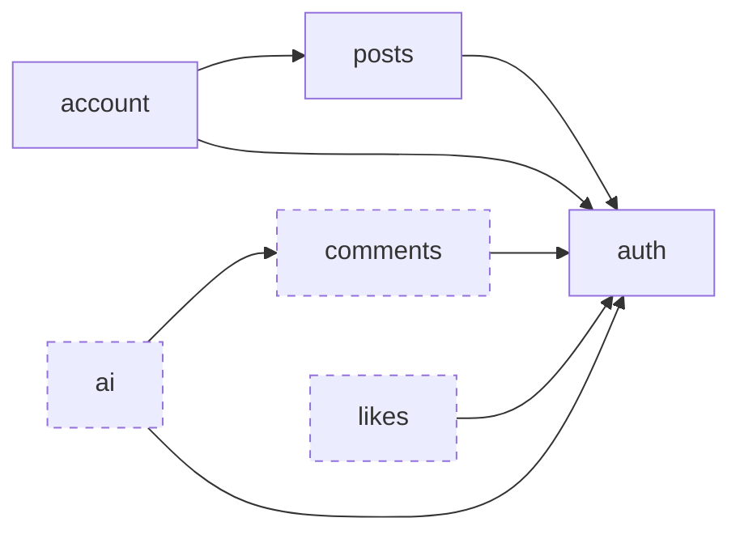

# Frontend

> **Status:** partly built. The app in `frontend/` has the pages for accounts and posts: registering, logging in, reading, writing, editing and deleting posts, the TL;DR, profiles and account deletion. They work against the backend (`npm run dev`) and against the mock API (`npm run dev:mock`), and CI runs the end-to-end tests against both. The backend also has comments, likes and AI replies; their pages in the app are *planned*.

Related documents:
- [API.md](API.md): the endpoints the app calls
- [DEVELOPMENT.md](DEVELOPMENT.md#frontend): installing, running and testing the app
- [TESTING.md](TESTING.md#frontend-tests): the frontend's tests
- [DECISIONS.md](DECISIONS.md): D18 to D22 explain the frontend's main choices

## Overview

The frontend is a single-page app: the browser downloads it once, and from then on it only exchanges JSON with the API. It lives in `frontend/`, next to the backend, in the same repository (see [D18](DECISIONS.md#d18-the-frontend-lives-in-the-same-repository)).

| Concern | Choice |
|---|---|
| Language | TypeScript (strict) |
| UI | React 19 |
| Build and dev server | Vite |
| Routing | React Router (data mode: `createBrowserRouter`) |
| Server data | TanStack Query |
| Styling | CSS Modules, with design tokens in CSS custom properties |
| Mock API | Mock Service Worker (MSW), in the browser and in tests |
| Tests | Vitest, Testing Library, MSW; Playwright for end-to-end tests |
| Lint and format | ESLint (with the feature boundary rules), Prettier |

There is no state library besides TanStack Query: server data lives in its cache, the login in the token store, and everything else in component state.

## Talking to the backend

The app calls the API under one path prefix, `/api`, on its own origin: `/api/posts`, `/api/auth/login`. Something in front of the backend removes the prefix:

- **In development**, the Vite dev server forwards `/api/*` to `http://localhost:8080/*` (`server.proxy` in `vite.config.ts`).
- **In production**, a reverse proxy does the same, and also serves the app's files (see [OPERATIONS.md](OPERATIONS.md#frontend)).

The browser therefore only ever talks to one origin, so the backend needs no CORS configuration for its own frontend (see [D19](DECISIONS.md#d19-the-browser-calls-the-api-on-its-own-origin)).

All HTTP goes through one function, `apiRequest` in `src/api/client.ts`:

- It sends the token, if there is one, in the `Authorization` header.
- It returns the parsed JSON, or `undefined` for `204 No Content`.
- Any other status throws an `ApiError` with the HTTP status, the API's `code` and the field errors of a `VALIDATION_FAILED` response. Two codes come from the client itself: `NETWORK_ERROR` when no response arrived, and `UNKNOWN` for an error response that is not Problem Details. A `401` without a body, as a proxy in front of the backend might send it, becomes `UNAUTHENTICATED`.
- A `401` to a request that carried a token means the token no longer works: it expired, or its account was deleted. The client forgets the token, which logs the user out, and sends a `GET` once more without it, so a public page still loads (as [API.md](API.md#authentication) advises). Writes are not sent again.

The resources are typed in `src/api/types.ts`, following [API.md](API.md#resources). `tldr` and `tldrStatus` are optional, so a post without them (as the backend returned them before its `ai` step) shows no TL;DR box. Fields the app doesn't use yet, such as `likeCount`, are left out.

## Features

The code is split into **features**, the frontend's version of the backend's modules. A feature is a folder in `src/features/` with an `index.ts` that is its public API: other code imports only from there, never from the feature's other files.

| Feature | Responsibility | Public API | Allowed dependencies |
|---|---|---|---|
| `auth` | The login state, logging in, registering, protecting pages | `AuthProvider`, `useAuth`, `RequireAuth`, `LoginPage`, `RegisterPage` | — |
| `posts` | Listing, reading, writing, editing and deleting posts; the TL;DR | `PostListPage`, `PostPage`, `NewPostPage`, `EditPostPage`, `PostList`, `postQueryKeys` | `auth` |
| `account` | The current user's account page, account deletion, public profiles | `AccountPage`, `UserPage` | `auth`, `posts` |
| `comments` | *Planned:* threads, replies, soft delete | | `auth` |
| `likes` | *Planned:* liking posts and comments | | `auth` |
| `ai` | *Planned:* asking the AI to reply, and following the request | | `auth`, `comments` |



An arrow means "may use". Dashed features are planned.

The shared code sits below the features, and any feature may use it:

| Folder | Contents | May use |
|---|---|---|
| `src/api/` | The HTTP client, the token store, the resource types | nothing else in `src` |
| `src/lib/` | Plain functions and hooks: validation rules, error messages, time formatting | `api` |
| `src/components/` | Shared UI: buttons, fields, alerts, avatars, pagination, empty and loading states | `api`, `lib` |
| `src/features/` | The features | the shared folders, and the features they are allowed |
| `src/app/` | The route table, the layout, the providers, the query client | everything |

**How the rules are checked.** ESLint fails the build on a forbidden import, the way `ModularityTests` does for the backend. The allowed dependencies are declared once, in `allowedFeatureDependencies` at the top of `eslint.config.js`. The rules:
- Files outside the current folder are imported with the `@/` alias (`@/components/Button`), never with `../`, so every rule can look at one kind of path.
- `@/features/<name>/<file>` is refused everywhere: only `@/features/<name>` (the index) may be imported.
- A feature may import only the features it is allowed.
- `api`, `lib` and `components` may not import features or `app`.
- Production code may not import `src/mocks` or `src/test`. The one exception is `main.tsx`, which loads the mock API in mock mode (see [Mock API](#mock-api)).
- Tests, the mock API and the test helpers may import anything, like the backend's module tests.

A forbidden import fails with a message that says what is allowed, for example:

```
'@/features/posts' import is restricted from being used by a pattern. The auth feature may only use: no other feature
```

## Pages

| URL | Page | Feature | Access | Endpoints |
|---|---|---|---|---|
| `/` | Latest posts | `posts` | public | `GET /posts` |
| `/posts/:id` | One post, with its TL;DR; Edit and Delete for its author | `posts` | public | `GET /posts/{id}`, `DELETE /posts/{id}` |
| `/posts/new` | Write a post | `posts` | logged in | `POST /posts` |
| `/posts/:id/edit` | Edit a post | `posts` | logged in, author | `GET /posts/{id}`, `PUT /posts/{id}` |
| `/users/:id` | A user's profile and posts | `account` | public | `GET /users/{id}`, `GET /posts?authorId=` |
| `/account` | Your account, your posts, deleting the account | `account` | logged in | `GET /posts?authorId=`, `POST /me/delete` |
| `/login` | Log in | `auth` | public | `POST /auth/login` |
| `/register` | Create an account | `auth` | public | `POST /auth/register` |
| anything else | Not found | `app` | public | |

`GET /me` is called on every page while a token is present, to know who is logged in. The route table is in `src/app/routes.tsx`.

Pages that need a login sit under the `RequireAuth` layout route. It sends anonymous users to `/login?redirect=<the page>`, and the login page sends them back afterwards. The redirect target must be a path in the app (`safeRedirect`), so a crafted link cannot send the user to another site after they enter their password.

The page for editing a post hides the form from anyone but the author. That only spares them typing in vain: the API is what enforces it (`403 NOT_AUTHOR`).

## Login state

- **The token store** (`src/api/token.ts`) keeps the access token and its expiry time in `localStorage`, so a login survives a reload and is shared by the app's tabs. It notifies subscribers when the token changes, including when another tab logs in or out. Why `localStorage`, and what it costs, is [D20](DECISIONS.md#d20-the-access-token-is-kept-in-localstorage).
- **`AuthProvider`** (`auth` feature) reads the token from the store and loads its account with `GET /me`. It gives every component `useAuth()`, with a `state` that is `anonymous`, `loading` or `authenticated` (with `me`), and `logIn` and `logOut`. It also logs the user out when the token expires.
- **Logging out** forgets the token in the browser. The API has no logout endpoint, so the token itself stays valid until it expires ([SECURITY.md](../SECURITY.md#known-limitations)).
- **Registering does not log in**, as in the API: the registration page leads to the login page, with the email filled in.

## Server data

TanStack Query fetches the API's data, caches it, and refreshes it. Each query has a key; post keys start with `'posts'` (`postQueryKeys` in `posts/queries.ts`), so one call can mark every cached post and list as out of date.

- **Fresh for 30 seconds** (`staleTime`): returning to a page within that time shows it at once, without a request.
- **Retries:** a network error or a `5xx` is tried twice more; a `4xx` is not, because asking again won't change the answer.
- **After a change**, the mutation puts the returned post into the cache and invalidates the lists, so they reload when shown.
- **The TL;DR is written in the background** ([ARCHITECTURE.md](ARCHITECTURE.md#async-ai-processing)). While a post's `tldrStatus` is `PENDING`, its page asks again every 3 seconds, and shows the summary as soon as it is ready. A pending post that has an older TL;DR shows it, marked "Updating…".
- **Lists are paged** in the URL (`?page=2`, counting from 1 for people; the API counts from 0), so the back button, reloading and sharing a link keep the page. While the next page loads, the current one stays on screen.
- **Deleting the account** marks every cached query as out of date, because the account's posts now have a `null` author.

## Forms and errors

- **Validation in the browser** (`src/lib/validation.ts`) repeats the rules from [API.md](API.md#validation), so the user sees a problem before submitting. The server checks again and has the last word. Lengths are counted the way the server counts them: titles and content in UTF-16 code units (JavaScript's `length` and Java's `@Size` agree), passwords in UTF-8 bytes.
- **Errors appear after the first submit**, next to their field, and update as the user types. A field with an error is marked `aria-invalid`, and its message is linked with `aria-describedby`, so screen readers announce it.
- **Server errors** are matched by `code`, never by their text (`src/lib/errors.ts`). A `VALIDATION_FAILED` response's field errors, and the conflicts `EMAIL_TAKEN` and `USERNAME_TAKEN`, appear next to their fields; a wrong password next to the password; anything else above the form.
- **Content is plain text** ([D12](DECISIONS.md#d12-content-is-plain-text)). Posts are shown with `white-space: pre-wrap`, so line breaks are kept, and React escapes everything. `dangerouslySetInnerHTML` is forbidden by a lint rule (see [SECURITY.md](../SECURITY.md#frontend)).

## Mock API

`src/mocks/` holds a mock of the backend, written with [Mock Service Worker](https://mswjs.io). It intercepts the app's requests to `/api` and answers them from an in-memory database:

- `db.ts`: the data and the rules from [DOMAIN.md](DOMAIN.md): emails stored in lower case, usernames unique ignoring case (the bot's and deleted accounts' included), deleted accounts as tombstones whose posts show a `null` author, a TL;DR rewritten only when the content changes.
- `handlers.ts`: the endpoints, with the status codes, error codes and Problem Details bodies from [API.md](API.md).
- `server.ts`: the mock for tests, in Node.
- `browser.ts` and `seed.ts`: the mock for `npm run dev:mock`, with demo data.

**It follows the design.** It answers every endpoint the app uses, as [API.md](API.md) describes them, so a page can be built and tested before its endpoint exists. The backend now has all of them, and answers alike, apart from details the app doesn't depend on:

| Mock | Backend |
|---|---|
| Login issues a fake token, `mock-token.<user id>`, valid for an hour | A signed JWT, valid for `blog.auth.token-ttl` |
| A fake AI writes the TL;DR (the content's first sentence) 2.5 seconds after a change, or at once in tests | The AI worker writes it; in the `dev` profile, its fake LLM answers with a fixed text |
| Posts have no `likeCount` | Posts have `likeCount` |
| Validation and error texts imitate the backend's English ones | The real texts |

The end-to-end tests run against both (`npm run e2e` and `npm run e2e:backend`), and so does CI, so a difference that matters to the app fails a build. A difference is a bug in one of the two, and the docs decide which. [D21](DECISIONS.md#d21-a-mock-api-built-from-the-design) explains the choice.

**In the browser** (`npm run dev:mock`), the mock keeps its data in `localStorage` under `blog.mockDb`, so it survives reloads. The first start adds demo data: four users, one of them deleted, and four posts. Log in as `demo@example.com` with `password123`. To start over, clear the site's data in the browser, or run `localStorage.removeItem('blog.mockDb')` in its console and reload.

The mock is only in development: `main.tsx` loads it when `import.meta.env.DEV` is true and `VITE_API_MOCK` is `"true"` (set in `.env.mock`). Production builds contain neither the handlers nor MSW's service worker; `vite.config.ts` applies MSW's Vite plugin to the dev server only.

## Styling

- **Design tokens** in `src/styles/tokens.css`: every colour, font, size, radius and shadow is a CSS custom property. Components use the tokens, never raw values, so the dark theme (`prefers-color-scheme: dark`) only redefines them.
- **CSS Modules**: each component has a `*.module.css` file next to it. Class names are local to the file, so components can't break each other's styles.
- **Global styles** (`src/styles/global.css`) only cover plain elements, plus two utility classes: `.reading` (the text column, about 70 characters wide) and `.visually-hidden`.
- **Type:** a system sans-serif for the interface, and a serif for titles and post content. No web fonts are loaded.
- **The AI's work is always marked**: the TL;DR box and the bot's avatar use the AI gradient, and the bot has an "AI" badge.
- **Accessibility:** every input has a label; errors are announced; focus is always visible; a "Skip to content" link comes first; animations stop when the system asks for reduced motion; pages set the tab's title.
- **Responsive:** one column, with margins that shrink on narrow screens.

## Conventions

- **Files:** one component per file, named after it (`PostCard.tsx`, with `PostCard.module.css`). Hooks start with `use`. Each feature's API calls are in its `api.ts`, and its TanStack Query hooks in `queries.ts`.
- **Comments:** every file starts with a short comment that says what it is for and where it fits: its feature, and whether it is part of the feature's public API. Exported functions get a comment for anything their signature doesn't say. Otherwise the [comment rules in CONTRIBUTING.md](../CONTRIBUTING.md#comments) apply.
- **Time:** components never read the clock while rendering. They use `useNow()`, which refreshes every minute, and functions that format time take the current time as an argument, the way backend code takes the `Clock`.
- **State:** derive what you can while rendering instead of copying it into state with an effect. Forms keep their own state and start over through a `key`.
- **Text:** say what happened and what to do, in plain English. Error messages come from `src/lib/errors.ts`, keyed by code.
- **Types:** no `any`. Data from the API is typed with `src/api/types.ts`.
- **Format:** Prettier formats the code (`npm run format`), and CI checks it.

## Adding a feature

1. **Folder:** `src/features/<name>/` with an `index.ts` that exports the pages and anything other features need.
2. **Boundaries:** add the feature and its allowed dependencies to `allowedFeatureDependencies` in `eslint.config.js`, and to the [Features](#features) table.
3. **Types:** add the resources from [API.md](API.md#resources) to `src/api/types.ts`.
4. **API calls:** `api.ts`, using `apiRequest`.
5. **Queries:** `queries.ts`, with query keys that start with the feature's name, and mutations that update or invalidate the cache.
6. **Mock API:** the endpoints in `src/mocks/handlers.ts` and the rules in `src/mocks/db.ts`, following [API.md](API.md) and [DOMAIN.md](DOMAIN.md).
7. **Pages and components**, with their CSS modules. Add routes to `src/app/routes.tsx`; pages that need a login go under `RequireAuth`.
8. **Tests:** page tests next to the pages, unit tests for any logic, and an end-to-end test for the main flow. Cover the feature's [required tests](TESTING.md#required-frontend-tests).
9. **Docs:** this document (pages, features, *planned* notes), and the others listed in [Keeping the docs current](../CONTRIBUTING.md#keeping-the-docs-current).
10. **Check:** `npm run check` and `npm run e2e` pass.
